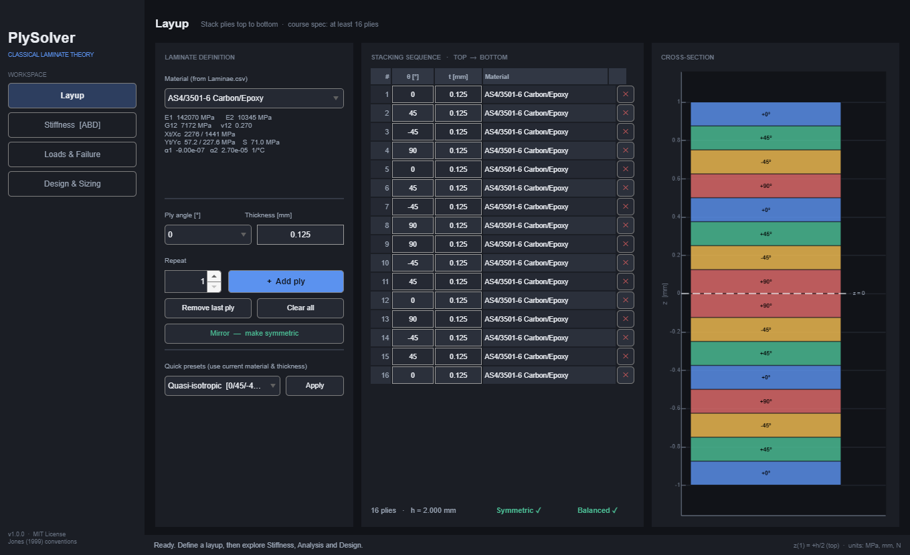
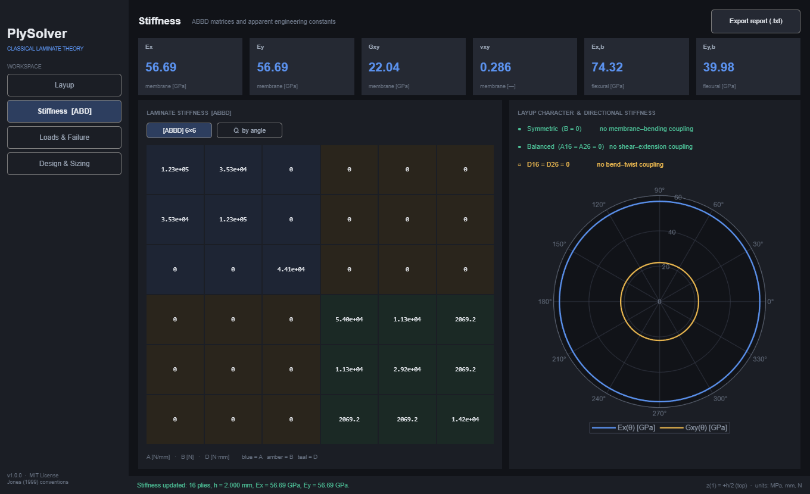
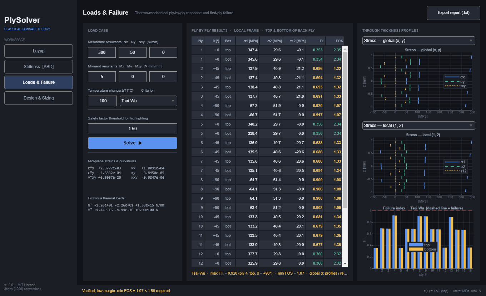
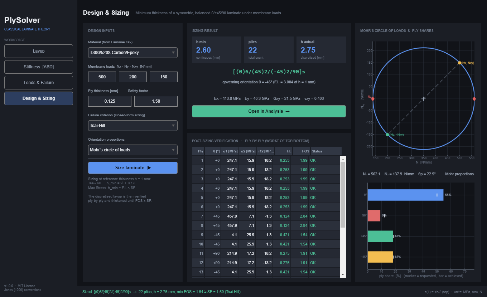

# PlySolver

**Composite laminate analysis & design toolbox for MATLAB** — Classical Laminate Plate Theory (CLPT) with a modern desktop UI: build a layup, get ABBD stiffness and engineering constants, run thermo-mechanical ply-by-ply failure checks, and size a laminate from the loads — all in one tool.




## Why

Born as two separate tools — one for laminate *analysis*, one for laminate *sizing* — PlySolver merges them into a single engineering tool built around the workflow a designer actually follows:

```
DESIGN  →  size the laminate from the loads (h_min, ply count, stacking sequence)
   ↓          one click
ANALYSIS →  verify it rigorously: full CLPT, thermal effects, first-ply failure
```

The **Design → Open in Analysis** hand-off closes the loop: the sized laminate is loaded into the analysis module together with its load case and re-verified with the full ABBD solution — and the safety factor you were promised is the safety factor you get.

## Modules

| Module | What it does |
|---|---|
| **Layup** | Interactive stacking-sequence editor: 15-material database (`Laminae.csv`), 0/±30/±45/±60/90 plies, per-ply thickness, quick presets, one-click *Mirror* to make a laminate symmetric, live cross-section preview and symmetry/balance badges. |
| **Stiffness** | [A], [B], [D] and assembled 6×6 ABBD matrix, apparent membrane and flexural engineering constants, coupling diagnostics (symmetric / balanced / bend–twist), transformed stiffness Q̄(θ) tables, and a **polar plot of Ex(θ), Gxy(θ)** — quasi-isotropic layups draw perfect circles. |
| **Loads & Failure** | Any combination of N = [Nx Ny Nxy], M = [Mx My Mxy] and a uniform ΔT. Mid-plane strains/curvatures, fictitious thermal loads Nᵀ/Mᵀ, stresses and strains at top & bottom of every ply (global and material frame), through-thickness profiles, and first-ply-failure check with **Tsai-Wu, Tsai-Hill or Max Stress** (failure index + strength-ratio FOS). |
| **Design & Sizing** | Minimum thickness of a symmetric, balanced 0/±45/90 laminate under membrane loads: orientation proportions from **Mohr's circle of the loads** (or quasi-isotropic), closed-form h_min, discretisation into plies, LSS string, and an automatic thicken-until-verified loop that guarantees FOS ≥ SF on the real, discretised laminate. |

| Stiffness | Loads & Failure | Design & Sizing |
|---|---|---|
|  |  |  |

## Quick start

```matlab
>> PlySolver
```

That's it — no toolboxes required. Requires MATLAB **R2021a or newer** (developed and tested on R2024b).

The computational core is a plain function package, usable without the GUI:

```matlab
addpath src
mats  = clpt.loadMaterials('data/Laminae.csv');
plies = struct('theta', num2cell([0 45 -45 90 90 -45 45 0]), ...
               't', num2cell(0.125*ones(1,8)), 'mat', mats(5));

L = clpt.laminate(plies);                    % ABBD, z, layup flags
E = clpt.apparentConstants(L);               % Ex, Ey, Gxy, vxy, flexural
R = clpt.solveLoads(L, [500;0;0], [0;0;0], -100, 'Tsai-Wu');
fprintf('max FI = %.3f  min FOS = %.2f\n', R.maxFI, R.minFOS);
```

## Architecture

```
PlySolver/
├── PlySolver.m           entry point (adds paths, launches the app)
├── data/Laminae.csv      lamina database (15 materials, MIL-HDBK-17 & literature data)
├── src/
│   ├── +clpt/            computational core — pure, GUI-free, tested
│   │   ├── laminate.m           ABBD assembly, geometry, layup checks
│   │   ├── solveLoads.m         thermo-mechanical ply-by-ply solution
│   │   ├── failureIndex.m       Tsai-Wu / Tsai-Hill / Max Stress + FOS
│   │   ├── sizeLaminate.m       minimum-thickness design loop
│   │   ├── directionalModuli.m  Ex(θ), Gxy(θ) via exact [A] rotation
│   │   └── ...                  qbar, transforms, thermal loads, Mohr
│   └── PlySolverApp.m    the UI (programmatic uifigure app, dark theme)
├── tests/                validation suite (run_all_tests.m)
└── tools/                screenshot generator / GUI smoke test
```

UI and physics are strictly separated: every number shown in the app comes from `+clpt`, and everything in `+clpt` is covered by the test suite.

## Validation

`tests/run_all_tests.m` (also runs headless: `matlab -batch "cd tests; run_all_tests"`) checks the implementation against closed-form solutions and physical invariants rather than against itself:

- **Transformations** — Q̄ limit cases, trace invariant under rotation, explicit Jones formulas vs. general tensor rotation, T(θ)⁻¹ = T(−θ).
- **Laminate** — unidirectional laminate must return the lamina constants exactly; cross-ply A11 closed form; quasi-isotropic layup must give Ex = Ey, G = E/2(1+ν) and a **flat Ex(θ)**; UD Ex(θ) vs. the textbook off-axis modulus formula.
- **Thermal** — free expansion of a UD laminate produces zero stress; symmetric laminates have Mᵀ = 0 and zero curvature; through-thickness stress integral equals the applied load (equilibrium), with and without ΔT.
- **Failure criteria** — FI = FOS = 1 exactly at every uniaxial strength; strength-ratio scaling R(λσ) = R(σ)/λ.
- **Sizing** — hand-computed Mohr circle; proportion rules; sized laminates are symmetric, balanced, meet h ≥ h_min and verified FOS ≥ SF; equilibrium of the verification solution.

## Theory in one breath

Plane-stress reduced stiffness $Q_{ij}$ from $E_1, E_2, G_{12}, \nu_{12}$; rotation to $\bar{Q}(\theta)$ (Jones, *Mechanics of Composite Materials*, 2nd ed.); laminate stiffness

$$A_{ij}=\sum_k \bar{Q}_{ij}^{(k)}(z_k-z_{k+1}),\quad B_{ij}=\tfrac12\sum_k \bar{Q}_{ij}^{(k)}(z_k^2-z_{k+1}^2),\quad D_{ij}=\tfrac13\sum_k \bar{Q}_{ij}^{(k)}(z_k^3-z_{k+1}^3)$$

constitutive equation $[N+N^T;\,M+M^T]=\mathrm{ABBD}\,[\varepsilon^0;\,\kappa]$ with thermal loads $N^T=\Delta T\sum_k \bar{Q}^{(k)}\alpha^{(k)}(z_k-z_{k+1})$; ply stresses $\sigma=\bar{Q}(\varepsilon^0+z\kappa-\Delta T\,\alpha)$; first-ply failure by Tsai-Wu ($F_{12}^*=-\tfrac12$), Tsai-Hill or Max Stress. Full derivations and conventions in [docs/THEORY.md](docs/THEORY.md).

Conventions: ply 1 is the **top** ply, $z(1)=+h/2$; units MPa, mm, N.

## Roadmap

- [ ] Free ply angles beyond the ±30/±45/±60/90 set (core already supports them)
- [ ] Hygroscopic loads (CME columns are already in the database)
- [ ] Carpet plots and laminate optimization
- [ ] Report export to PDF/HTML

## Acknowledgments

Material data in `Laminae.csv` is compiled from MIL-HDBK-17 and public composites literature. Theory follows R.M. Jones, *Mechanics of Composite Materials*, 2nd ed., Taylor & Francis, 1999.

## License

[MIT](LICENSE)
